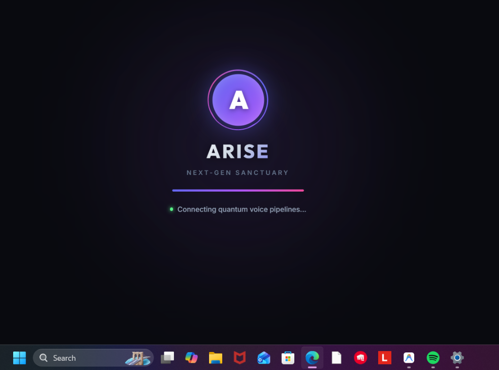
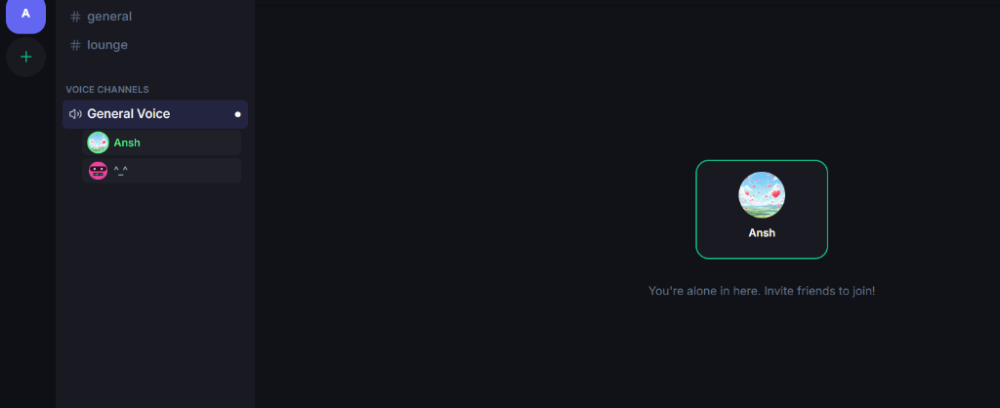
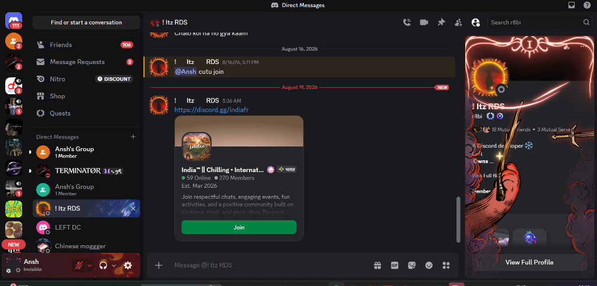

<div align="center">

# ⚡ ARISE
### High-Performance Real-Time Voice, Video & Community Platform
*Built with Next.js 16, React 19, WebRTC Mesh Architecture & WebSockets*

<br/>

[](https://nextjs.org/)
[](https://react.dev/)
[](https://www.typescriptlang.org/)
[](https://webrtc.org/)
[](https://socket.io/)
[](https://www.prisma.io/)
[](https://tailwindcss.com/)

<br/>

[Live Demo](#-live-preview) • [Features](#-features) • [System Architecture](#-system-architecture) • [Engineering Highlights](#-engineering-highlights) • [Getting Started](#-getting-started)

<br/>



</div>

---

## 📌 Executive Summary

**Arise** is a production-grade, Discord-inspired real-time collaboration engine designed to showcase full-stack system architecture and low-latency networking capabilities. 

Unlike traditional chat apps that rely purely on polling or third-party paid SDKs (like Agora or Twilio), **Arise implements native WebRTC Mesh topologies from scratch**, coupled with a stateful bidirectional WebSocket signaling pipeline. This enables persistent voice channels, real-time 1080p 60fps screen sharing, active speaker detection, and instant messaging with sub-50ms latency.

---

## 📸 Visual Showcase

<div align="center">

| 🎙️ WebRTC Voice Stage & Active Speaker Rings | 💬 Real-Time Messaging & Direct Channels |
| :---: | :---: |
|  |  |
| *Mesh WebRTC audio stream with live speaker detection* | *WebSocket sub-millisecond message delivery* |

</div>

---

## 🎯 Key Features

### 🎙️ 1. Multi-User WebRTC Voice Channels (Full Mesh)
- **Zero-Latency Peer Audio**: Fully native `RTCPeerConnection` mesh with dynamic ICE candidate negotiation.
- **Failover & NAT Traversal**: Dual STUN/TURN fallback servers ensure seamless connectivity across restrictive firewalls and mobile networks.
- **Active Speaker Recognition**: Audio level processing using the `Web Audio API` (`AnalyserNode`) detects decibel spikes and renders glowing speaker rings in real time.
- **Persistent Voice Connection**: Seamlessly browse servers, channels, and direct messages without dropping voice connectivity or triggering reconnection loops.

### 🖥️ 2. HD Screen Sharing & Stage Theater
- **1080p 60fps Desktop Streaming**: Low-latency screen capture using browser MediaDevices Display APIs.
- **Theater Mode**: Interactive participant stage with full-screen toggles and automatic stream layout adjustments.

### 💬 3. Direct Messaging & 1-on-1 Calls
- **Real-Time DMs**: Instant peer-to-peer and group messaging via WebSockets (`socket.io`).
- **Interactive Call Signaling**: Real-time incoming call overlays with custom audio synthesizers (`Web Audio Oscillator`) simulating native ringtones.
- **Live User Presence**: Heartbeat-based online/idle/offline status synchronization.

### 🛡️ 4. Server & Channel Management
- **Hierarchical Server Architecture**: Support for text channels, voice stages, and custom channel categories.
- **Role-Based Access**: Permission-controlled actions and invite link generator with expiry hashing.

---

## 🏗️ System Architecture

```
                          ┌─────────────────────────────────────┐
                          │         Next.js Client UI           │
                          │   (React 19 + Framer Motion)        │
                          └──────────┬──────────────┬───────────┘
                                     │              │
                   HTTPS / REST API  │              │  WebSockets (Signaling)
                                     ▼              ▼
                          ┌─────────────────────────────────────┐
                          │      Custom Node.js Server          │
                          │  - Next.js Turbopack Handlers       │
                          │  - Socket.io Engine (Mesh Signaling)│
                          └──────────┬──────────────┬───────────┘
                                     │              │
                        Query Engine │              │ STUN/TURN Negotiation
                                     ▼              ▼
                     ┌──────────────────┐    ┌──────────────────────┐
                     │  Prisma + SQLite │    │ OpenRelay TURN Pool  │
                     │  (Persistent DB) │    │ (NAT Traversal Mesh) │
                     └──────────────────┘    └──────────────────────┘
```

---

## 🔬 Engineering & Architecture Highlights

### ⚡ Persistent WebRTC Without Socket Disconnect Loops
- **The Challenge**: In complex single-page apps, re-rendering stateful views (switching channels or servers) typically re-triggers parent `useEffect` hooks, leading to socket disconnections that drop active WebRTC calls.
- **The Solution**: Designed an isolated `createPeerConnectionRef` decoupling pattern. The primary WebSocket listener remains permanently mounted without depending on dynamic view-state callbacks, keeping audio streams uninterrupted during navigation.

### 🎧 Clean Buffer Mic Testing (Echo-Free)
- Replaced traditional raw loopback audio (which causes metallic robotic feedback) with a lightweight **MediaRecorder 2.5-second buffer system** that captures audio and plays it back locally for a clean user mic check experience.

---

## 🧰 Tech Stack Breakdown

| Layer | Technologies Used |
|---|---|
| **Client Core** | Next.js 16.3 (App Router), React 19, TypeScript 5 |
| **Styling & Motion** | Tailwind CSS 4, CSS Modules, Framer Motion, Lucide Icons |
| **Real-Time Protocols** | WebSockets (Socket.io 4.8), WebRTC (RTCPeerConnection, MediaStream API) |
| **Audio Processing** | Web Audio API (`AudioContext`, `AnalyserNode`, `OscillatorNode`) |
| **Backend Runtime** | Node.js (Custom HTTP + Socket.io Server Architecture) |
| **Database & ORM** | SQLite / Better-SQLite3, Prisma ORM 6 |
| **Security & Auth** | JWT Authentication, Bcrypt Password Hashing, HTTP-only Cookie Storage |

---

## 🏁 Quickstart Guide

### Prerequisites
- Node.js `>= 20.19.0`
- npm or pnpm

### 1. Clone the repository
```bash
git clone https://github.com/ansh44233/arise.git
cd arise
```

### 2. Install dependencies
```bash
npm install
```

### 3. Setup environment variables
Create a `.env` file in the root directory:
```env
DATABASE_URL="file:./dev.db"
JWT_SECRET="arise-super-secret-jwt-key"
PORT=3000
```

### 4. Push database schema & start development
```bash
npx prisma generate
npm run dev
```

Visit **`http://localhost:3000`** in your browser.

---

## 👨‍💻 Author & Rights
**ansh44233**
- GitHub: [@ansh44233](https://github.com/ansh44233)
- Project Repository: [https://github.com/ansh44233/arise](https://github.com/ansh44233/arise)

---

## 📄 License
This project is open-source and licensed under the [MIT License](LICENSE) © 2026 **ansh44233**. All rights reserved.

<br/>

<div align="center">
  <sub>Engineered with focus on real-time systems, network topologies, and responsive UX.</sub>
</div>
